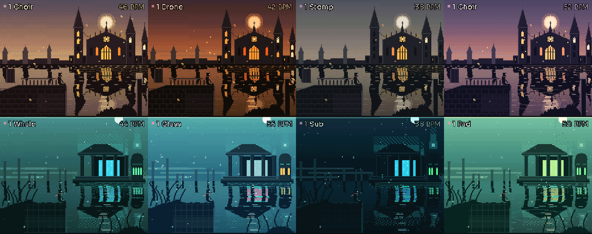
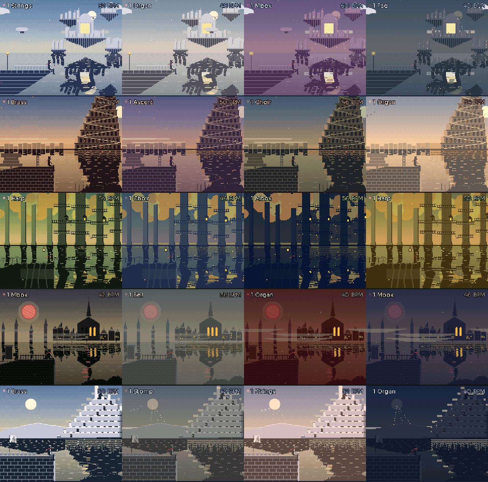

# SKYLYNNE

Ambient firmware for the M-VAVE FM-1. Six voices play themselves on one tempo and scale. Four macro knobs
(DENSITY, MOTION, COLOUR, SPACE) shape them, and each voice can be edited: type, level, pan, sustain, tone.
Long drones, thin whistles, a deep sub and a very large reverb.

The presets are grouped in worlds, and each world has its own sounds and its own picture:

| World | Presets | Sounds (ALGORITHM walks this list) |
| --- | --- | --- |
| City at night | 1–8 | drone, whistle, sub, pad, air |
| The cathedral (Anor Londo) | 9–12 | choir, brass, organ, bell, forge, stomp, drone, pad, sub, whistle |
| The deep (Atlantis) | 13–16 | whale, drip, glass, bell, pad, air, sub, drone, whistle, choir |
| Columbia | 17–20 | strings, choir, harp, glass, music box, organ, bell, pad, whistle, drone, sub, air |
| Babel | 21–24 | brass, choir, forge, stomp, ascent (a tone that rises for ever), strings, organ, bell, drone, sub, pad, whistle |
| Lothlórien | 25–28 | harp, choir, strings, whistle, glass, bell, drip, pad, air, music box, drone, sub |
| Yharnam | 29–32 | music box, strings, organ, bell, choir, brass, forge, stomp, whistle, drone, sub, air |
| Minas Tirith | 33–36 | brass, choir, strings, organ, bell, harp, stomp, whistle, pad, drone, sub, air |

The struck sounds (bell, forge, stomp, drip, harp, music box) are sparse by design.

## ARP and GLO

- **ARP** opens the arpeggiator on the selected voice (the other five carry on as they were; SELECT moves it to another voice). PATTERN: up, down, up-down, random, strum, even. RATE: 1/4, 1/8, 1/16, 1/16T, 1/32 of the BPM. RANGE: 1 to 3 octaves. GATE: note length. Pattern OFF (or a new preset) releases the voice.
- **GLO** turns Glow on and off. The figure stands, rises and floats in a ball of energy, lightning crosses the sky, and the six voices play a heroic loop of 4 to 32 bars (LOOP) that builds in four stages: pads and roots, then voices, then lead and sparkle, then everything with hits. POWER sets how quickly it builds and how hard it hits, BOLTS how often the sky answers, AURA the colour (gold, white, blue, green, red, violet).
- ARP and GLO settings are kept in the eight save slots.

A second page is a physics sequencer: a polygon spins, balls fall inside it, and every wall hit plays a note on
one of the voices.

The screen is a figure on the left looking over water, from a cliff, a terrace of old stone or a fallen column. The scene follows the preset you pick.

Try it in the browser before installing anything: build with `tools/build_web.sh` and open `build/web/play/`
(or use the published page).

## Controls

| Control | Does |
| --- | --- |
| SELECT | pick the voice |
| ALGORITHM | voice type |
| PRESETS | biome (on the physics page: number of sides) |
| K1–K4 | DENSITY, MOTION, COLOUR, SPACE (on a voice page: LEVEL, PAN, DECAY, MATERIAL) |
| OCT− / OCT+ | tempo |
| PLAY | hold |
| keys 1–6 | mute voices; other keys play the selected voice |
| MASTER | output volume |

## Build

- `./build.sh [--release X.Y]` builds the device package (needs the JieLi toolchain; CI does this).
- `tools/build_web.sh` builds the browser version (clang with wasm32 and lld).
- `tools/host/sk_host.c` is a script-driven host harness for screenshots and audio renders.

## Update mode

Hold OCT− at power-on, or inside SKYLYNNE hold OCT− + OCT+ + HOME for 5 seconds.

## Licence

GPL-3.0-only. See `LICENSING.md` for credits (Felucca and ChoralRoot for the hardware layer, Sora and Departure Mono
fonts, the JieLi SDK files).
